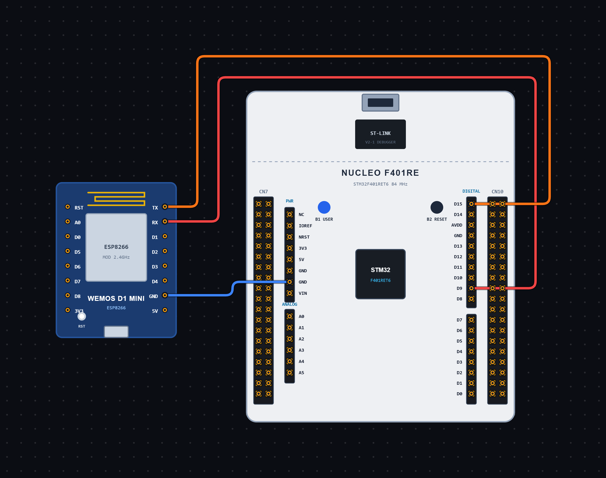

# Experiment Documentation

| Field | Description |
| :--- | :--- |
| **EXP** | CAT10 |
| **DATE** | 09/10/2026 |
| **NAME OF EXP** | ESP8266 Wi-Fi Module – AT Command Basic Test using UART on STM32F411RE |
| **HARDWARE SETUP / PLATFORM** | STM32F411RE (Nucleo-64), ARM Cortex-M4, ESP8266 Wi-Fi Module, USART6 (PC6-TX, PC7-RX), USB-to-Serial or ST-Link virtual COM, 3.3V power |
| **TASK NO** | TASK10A |

---

## Circuit Diagram



> **Hardware Connections:**
> - **Microcontroller:** STM32F411RE (Nucleo-64)
> - **Pin(s) Used:** PC6 (TX) → RX of ESP8266; PC7 (RX) → TX of ESP8266
> - **Peripheral(s):** ESP8266 Wi-Fi Module, USART6
> - **Power Supply:** ESP8266 VCC → 3.3V; CH_PD → 3.3V; GND common

---

## Core Logic / Pseudocode / Code Base

### Overview
USART6 is initialized at 115200 baud to communicate with the ESP8266. The firmware sends the "AT" command and waits for a response, confirming the module is alive and responsive.

### Core Logic
1. Initialize HAL and system clock; configure USART6 at 115200 baud
2. Send "AT\r\n" to ESP8266 and wait 1 second (basic module alive check)
3. Enter empty infinite loop (response can be monitored via UART passthrough)

### Implementation Snippet
```c
uint8_t cmd1[] = "AT\r\n";
HAL_UART_Transmit(&huart6, cmd1, sizeof(cmd1)-1, 2000);
HAL_Delay(1000);
while(1) { }
```

---

## Inference
The "AT" command was transmitted to the ESP8266 via USART6. A successful "OK" response confirmed module connectivity and proper UART communication at 115200 baud between the STM32F411RE and the ESP8266.
