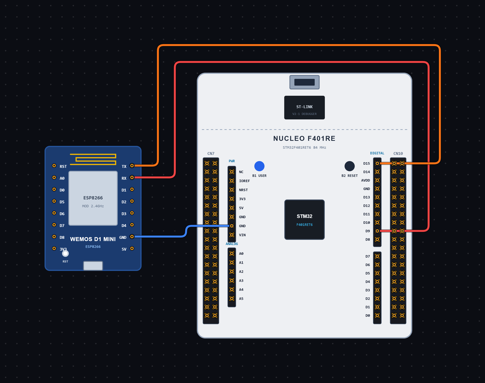

# Experiment Documentation

| Field | Description |
| :--- | :--- |
| **EXP** | CAT10 |
| **DATE** | 09/10/2026 |
| **NAME OF EXP** | ESP8266 Wi-Fi Module – Network Scan and Join using AT Commands on STM32F411RE |
| **HARDWARE SETUP / PLATFORM** | STM32F411RE (Nucleo-64), ARM Cortex-M4, ESP8266 Wi-Fi Module, USART6 (PC6-TX, PC7-RX), 3.3V power |
| **TASK NO** | TASK10B |

---

## Circuit Diagram



> **Hardware Connections:**
> - **Microcontroller:** STM32F411RE (Nucleo-64)
> - **Pin(s) Used:** PC6 (TX) → RX of ESP8266; PC7 (RX) → TX of ESP8266
> - **Peripheral(s):** ESP8266 Wi-Fi Module, USART6
> - **Power Supply:** ESP8266 VCC and CH_PD → 3.3V; GND common

---

## Core Logic / Pseudocode / Code Base

### Overview
AT commands sequence sets the ESP8266 to station mode, scans available APs, joins a target Wi-Fi network, and retrieves the assigned IP address.

### Core Logic
1. Initialize HAL, system clock; configure USART6 at 115200 baud
2. Send "AT" (alive check), then "AT+CWMODE=1" (station mode), then "AT+CWLAP" (list APs)
3. Send "AT+CWJAP=\"SNUC\",\"snu12345\"" to connect to Wi-Fi; wait 15 s for response
4. Send "AT+CIFSR" to retrieve assigned IP address

### Implementation Snippet
```c
HAL_UART_Transmit(&huart6, "AT+CWMODE=1\r\n", 13, 2000);
HAL_UARTEx_ReceiveToIdle(&huart6, rx, 512, &rxLen, 5000);
HAL_UART_Transmit(&huart6, "AT+CWJAP=\"SNUC\",\"snu12345\"\r\n", 28, 2000);
HAL_UARTEx_ReceiveToIdle(&huart6, rx, 512, &rxLen, 15000);
HAL_UART_Transmit(&huart6, "AT+CIFSR\r\n", 10, 2000);
```

---

## Inference
The ESP8266 was set to station mode, available APs were listed, and the module successfully joined the "SNUC" network. The assigned IP address confirmed successful DHCP lease, demonstrating AT-command-based Wi-Fi provisioning.
