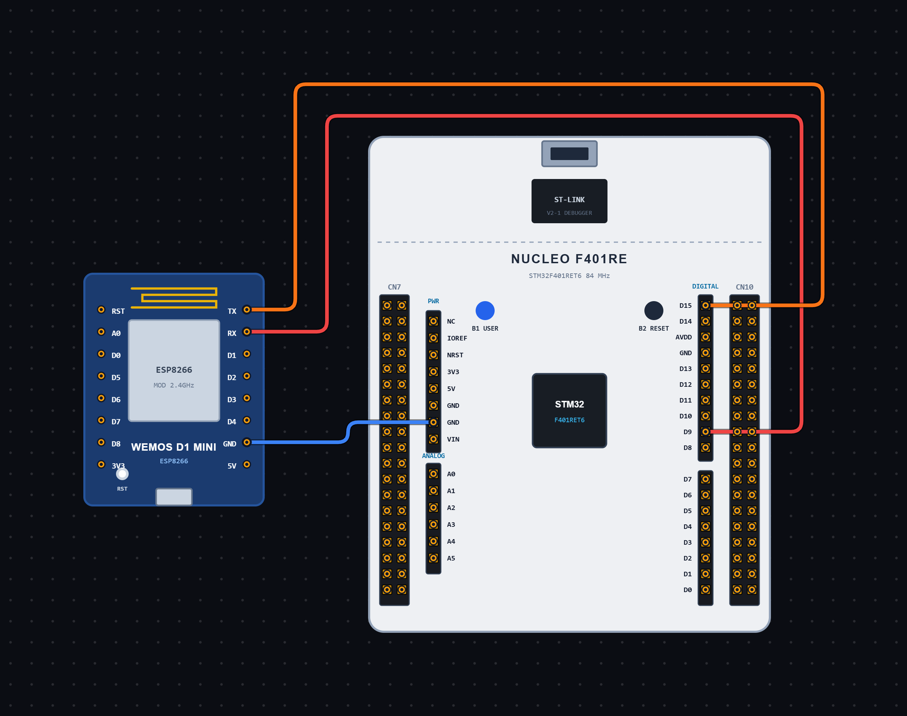

# Experiment Documentation

| Field | Description |
| :--- | :--- |
| **EXP** | CAT10 |
| **DATE** | 09/10/2026 |
| **NAME OF EXP** | ESP8266 Wi-Fi Module – TCP Server Setup on Port 80 using AT Commands on STM32F411RE |
| **HARDWARE SETUP / PLATFORM** | STM32F411RE (Nucleo-64), ARM Cortex-M4, ESP8266 Wi-Fi Module, USART6, 3.3V power |
| **TASK NO** | TASK10C |

---

## Circuit Diagram



> **Hardware Connections:**
> - **Microcontroller:** STM32F411RE (Nucleo-64)
> - **Pin(s) Used:** PC6 (TX) → ESP8266 RX; PC7 (RX) → ESP8266 TX
> - **Peripheral(s):** ESP8266 Wi-Fi Module, USART6
> - **Power Supply:** ESP8266 VCC and CH_PD → 3.3V; GND common

---

## Core Logic / Pseudocode / Code Base

### Overview
After joining a Wi-Fi network, the ESP8266 is configured to run a TCP server on port 80 using AT+CIPMUX and AT+CIPSERVER commands. The firmware then retrieves and stores the IP address.

### Core Logic
1. Initialize HAL, system clock, USART6 at 115200 baud
2. Send "AT+CIPSERVER=0" (stop any existing server), then "AT+CIPMUX=1" (enable multiple connections)
3. Send "AT+CIPSERVER=1,80" to start TCP server on port 80
4. Send "AT+CIFSR" to get the module IP; enter infinite loop to handle incoming connections

### Implementation Snippet
```c
HAL_UART_Transmit(&huart6, "AT+CIPMUX=1\r\n", 13, 2000);
HAL_Delay(1000);
HAL_UART_Transmit(&huart6, "AT+CIPSERVER=1,80\r\n", 19, 2000);
HAL_Delay(1000);
HAL_UART_Transmit(&huart6, "AT+CIFSR\r\n", 10, 2000);
while(1) { }
```

---

## Inference
A TCP server on port 80 was started on the ESP8266 using AT commands. The server IP obtained via AT+CIFSR was accessed from a browser on the same network, confirming that the ESP8266 can act as a lightweight IoT web server.
