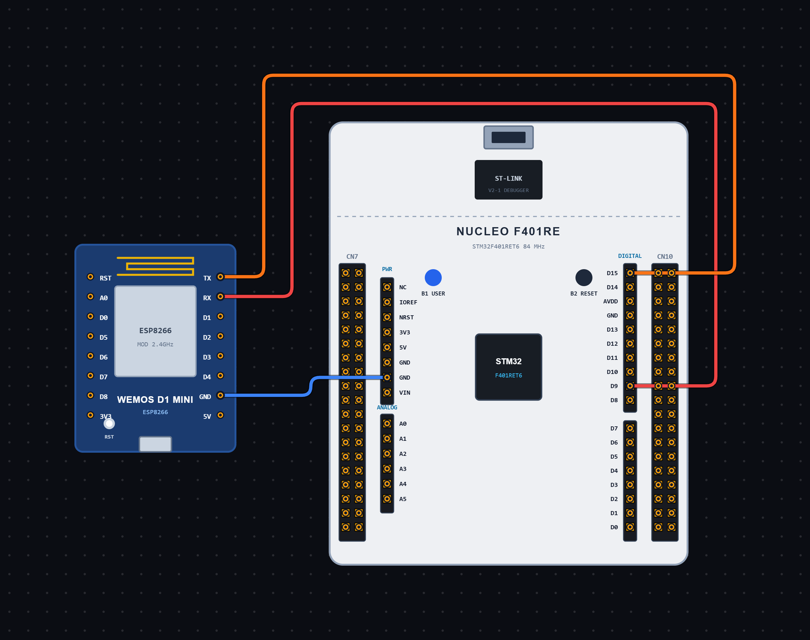

# Experiment Documentation

| Field | Description |
| :--- | :--- |
| **EXP** | CAT11 |
| **DATE** | 15/10/2026 |
| **NAME OF EXP** | ESP8266 Wi-Fi Module – TCP Server Configuration and IP Retrieval on STM32F411RE |
| **HARDWARE SETUP / PLATFORM** | STM32F411RE (Nucleo-64), ARM Cortex-M4, ESP8266 Wi-Fi Module, USART6 (PC6-TX, PC7-RX), 3.3V power |
| **TASK NO** | TASK11A |

---

## Circuit Diagram



> **Hardware Connections:**
> - **Microcontroller:** STM32F411RE (Nucleo-64)
> - **Pin(s) Used:** PC6 (TX) → ESP8266 RX; PC7 (RX) → ESP8266 TX
> - **Peripheral(s):** ESP8266 Wi-Fi Module, USART6
> - **Power Supply:** ESP8266 VCC and CH_PD → 3.3V; GND common

---

## Core Logic / Pseudocode / Code Base

### Overview
USART6 is configured at 115200 baud to send a sequence of AT commands that enable multi-connection mode and start a TCP server on port 80, then retrieve the IP address.

### Core Logic
1. Initialize HAL and USART6 at 115200 baud
2. Send AT+CIPSERVER=0, AT+CIPMUX=1, AT+CIPSERVER=1,80, AT+CIFSR in sequence
3. Remain in infinite loop awaiting connection events from ESP8266 over UART

### Implementation Snippet
```c
HAL_UART_Transmit(&huart6, "AT+CIPMUX=1\r\n", 13, 2000);
HAL_Delay(1000);
HAL_UART_Transmit(&huart6, "AT+CIPSERVER=1,80\r\n", 19, 2000);
HAL_Delay(1000);
HAL_UART_Transmit(&huart6, "AT+CIFSR\r\n", 10, 2000);
while(1) { }
```

---

## Inference
The ESP8266 TCP server on port 80 was successfully initialized. The board's IP was confirmed via AT+CIFSR. The server awaited HTTP client requests in the infinite loop, confirming correct multi-connection TCP server setup.
