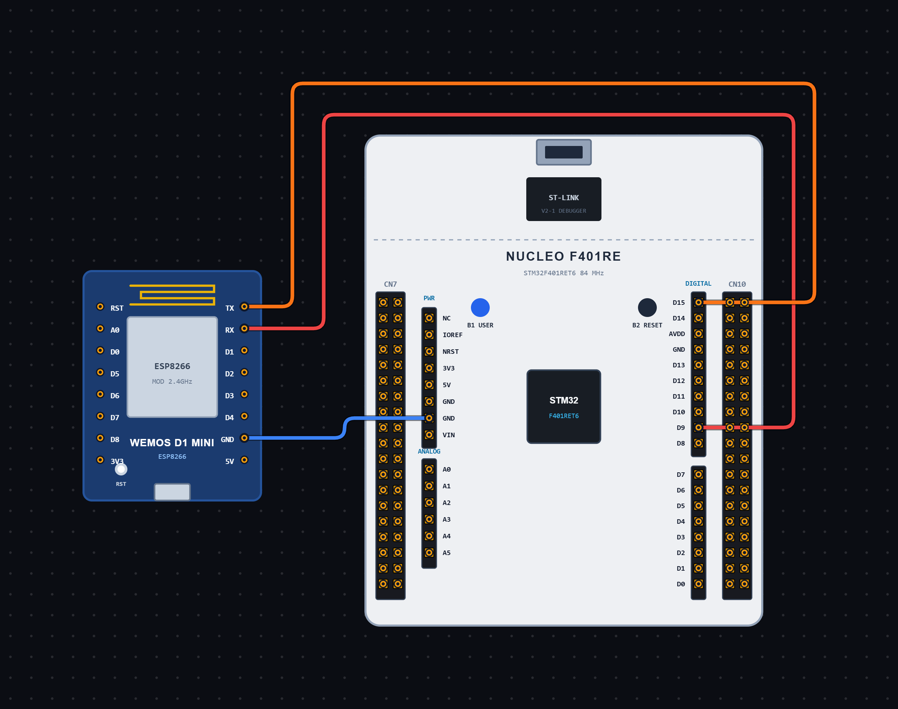

# Experiment Documentation

| Field | Description |
| :--- | :--- |
| **EXP** | CAT11 |
| **DATE** | 15/10/2026 |
| **NAME OF EXP** | ESP8266 Wi-Fi Module – TCP Server with Station Mode and Network Join on STM32F411RE |
| **HARDWARE SETUP / PLATFORM** | STM32F411RE (Nucleo-64), ARM Cortex-M4, ESP8266 Wi-Fi Module, USART6 (PC6-TX, PC7-RX), 3.3V power |
| **TASK NO** | TASK11B |

---

## Circuit Diagram



> **Hardware Connections:**
> - **Microcontroller:** STM32F411RE (Nucleo-64)
> - **Pin(s) Used:** PC6 (TX) → ESP8266 RX; PC7 (RX) → ESP8266 TX
> - **Peripheral(s):** ESP8266 Wi-Fi Module, USART6
> - **Power Supply:** 3.3V; GND common

---

## Core Logic / Pseudocode / Code Base

### Overview
Complete IoT connectivity flow: set station mode, scan and join Wi-Fi network, then configure TCP server on port 80, and retrieve IP address — all via AT commands over USART6.

### Core Logic
1. Initialize HAL and USART6 at 115200 baud
2. Set station mode (AT+CWMODE=1), scan APs (AT+CWLAP), join network (AT+CWJAP)
3. Configure TCP server: AT+CIPMUX=1, AT+CIPSERVER=1,80
4. Retrieve IP via AT+CIFSR; remain in infinite loop

### Implementation Snippet
```c
HAL_UART_Transmit(&huart6, "AT+CWMODE=1\r\n", 13, 2000);
HAL_UART_Transmit(&huart6, "AT+CWJAP=\"SNUC\",\"snu12345\"\r\n", 28, 2000);
HAL_UARTEx_ReceiveToIdle(&huart6, rx, 512, &rxLen, 15000);
HAL_UART_Transmit(&huart6, "AT+CIPSERVER=1,80\r\n", 19, 2000);
HAL_UART_Transmit(&huart6, "AT+CIFSR\r\n", 10, 2000);
while(1) { }
```

---

## Inference
The combined flow of Wi-Fi join and TCP server setup was validated. After joining "SNUC" in station mode and enabling TCP server on port 80, the IP address was successfully retrieved, confirming full IoT connectivity stack.
