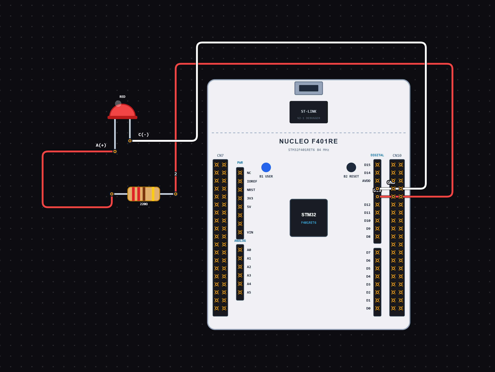

# Experiment Documentation

| Field | Description |
| :--- | :--- |
| **EXP** | CAT12 |
| **DATE** | 16/10/2026 |
| **NAME OF EXP** | Polling-Based Button Debounce and LED Toggle on STM32F411RE |
| **HARDWARE SETUP / PLATFORM** | STM32F411RE (Nucleo-64), ARM Cortex-M4, User Button (PC13 / active-high), On-board LED (PA5), ST-Link V2 |
| **TASK NO** | TASK12A |

---

## Circuit Diagram



> **Hardware Connections:**
> - **Microcontroller:** STM32F411RE (Nucleo-64)
> - **Pin(s) Used:** PC13 → On-board user button (active-high with internal pull-down); PA5 → On-board green LED (active-high)
> - **Peripheral(s):** On-board User Button, On-board LED
> - **Power Supply:** 3.3V via ST-Link

---

## Core Logic / Pseudocode / Code Base

### Overview
PC13 is polled for the on-board button (active-high). A 30 ms delay debounce plus button-release wait ensures each press produces exactly one LED toggle.

### Core Logic
1. Initialize HAL and GPIO; configure PA5 as output, PC13 as input
2. Initialize LED OFF (PA5 RESET)
3. Poll PC13 — if HIGH (button pressed): debounce 30 ms, re-read; if still HIGH → toggle led_state → drive PA5 accordingly; wait for button release + 30 ms debounce

### Implementation Snippet
```c
if(HAL_GPIO_ReadPin(GPIOC, GPIO_PIN_13) == GPIO_PIN_SET) {
    HAL_Delay(30);
    if(HAL_GPIO_ReadPin(GPIOC, GPIO_PIN_13) == GPIO_PIN_SET) {
        led_state = !led_state;
        HAL_GPIO_WritePin(GPIOA, GPIO_PIN_5,
            led_state ? GPIO_PIN_RESET : GPIO_PIN_SET);
        while(HAL_GPIO_ReadPin(GPIOC, GPIO_PIN_13) == GPIO_PIN_SET) {}
        HAL_Delay(30);
    }
}
```

---

## Inference
Each button press reliably toggled the LED due to 30 ms software debouncing and release-wait logic. No false triggers or missed presses were observed, validating polling-based debounce for Nucleo-64's on-board user button and LED.
