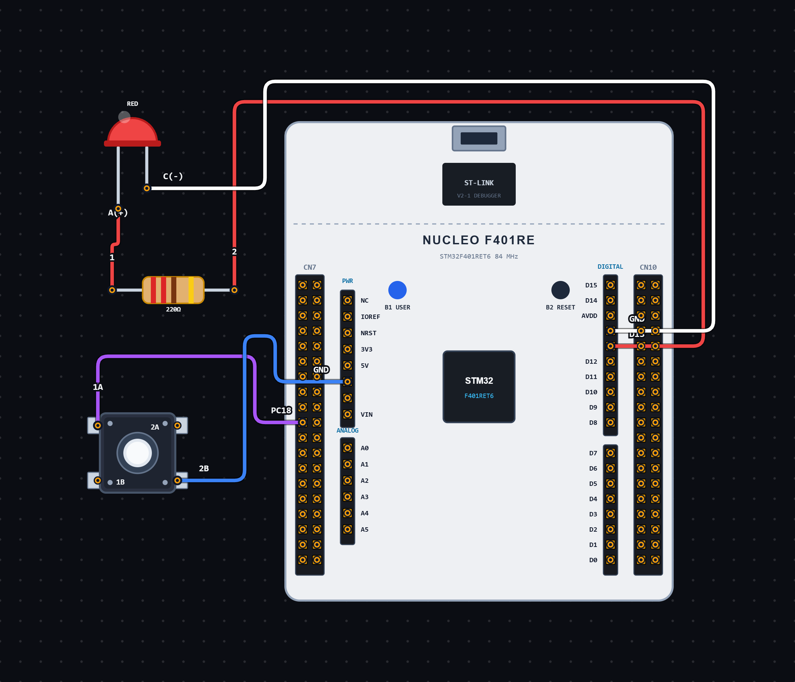

# Experiment Documentation

| Field | Description |
| :--- | :--- |
| **EXP** | CAT12 |
| **DATE** | 16/10/2026 |
| **NAME OF EXP** | Short Press Toggle and Long Press Blink Mode using HAL_GetTick() on STM32F411RE |
| **HARDWARE SETUP / PLATFORM** | STM32F411RE (Nucleo-64), ARM Cortex-M4, User Button (PC13, active-high), On-board LED (PA5), ST-Link V2 |
| **TASK NO** | TASK12B |

---

## Circuit Diagram



> **Hardware Connections:**
> - **Microcontroller:** STM32F411RE (Nucleo-64)
> - **Pin(s) Used:** PC13 → On-board user button; PA5 → On-board green LED
> - **Peripheral(s):** On-board User Button, On-board LED
> - **Power Supply:** 3.3V via ST-Link

---

## Core Logic / Pseudocode / Code Base

### Overview
Non-blocking timer-based state machine distinguishes short and long button presses using HAL_GetTick(). Short press toggles the LED once; long press activates continuous blinking without using HAL_Delay().

### Core Logic
1. Initialize HAL, GPIO; track press_start_time and blink_time using HAL_GetTick()
2. On button press: record press_start_time; if held > LONG_PRESS_TIME → blink LED every BLINK_INTERVAL ms using HAL_GetTick() comparison
3. On button release: if short press (long_press==0) → toggle LED once; if long_press → turn LED off and reset state

### Implementation Snippet
```c
if(HAL_GPIO_ReadPin(GPIOC, GPIO_PIN_13) == GPIO_PIN_SET) {
    if(button_pressed == 0) { button_pressed = 1; press_start_time = HAL_GetTick(); }
    if((HAL_GetTick() - press_start_time) >= LONG_PRESS_TIME) {
        long_press = 1;
        if((HAL_GetTick() - blink_time) >= BLINK_INTERVAL) {
            HAL_GPIO_TogglePin(GPIOA, GPIO_PIN_5);
            blink_time = HAL_GetTick();
        }
    }
} else {
    if(button_pressed == 1) {
        if(long_press == 0) HAL_GPIO_TogglePin(GPIOA, GPIO_PIN_5);
        button_pressed = 0;
    }
}
```

---

## Inference
Short press correctly toggled the LED in a non-blocking manner. Long press activated a continuous blink using HAL_GetTick() without HAL_Delay(), demonstrating timer-based state machine design for multi-function button behavior.
