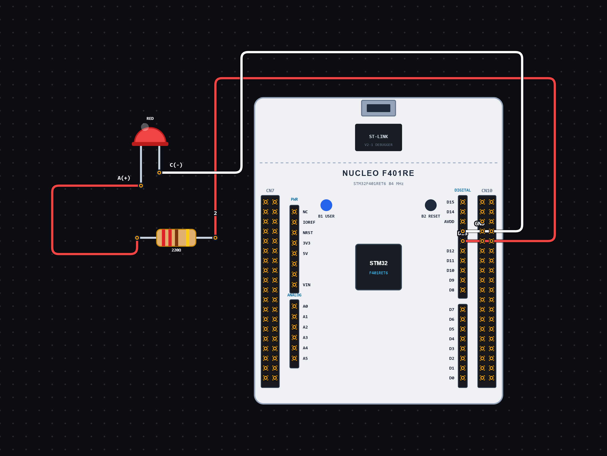

# Experiment Documentation

| Field | Description |
| :--- | :--- |
| **EXP** | CAT12 |
| **DATE** | 16/10/2026 |
| **NAME OF EXP** | External Button Toggle of External LED with Debounce on STM32F411RE |
| **HARDWARE SETUP / PLATFORM** | STM32F411RE (Nucleo-64), ARM Cortex-M4, External Push Button (PC13), External LED (PA5), 330Ω resistor, ST-Link V2 |
| **TASK NO** | TASK12C |

---

## Circuit Diagram



> **Hardware Connections:**
> - **Microcontroller:** STM32F411RE (Nucleo-64)
> - **Pin(s) Used:** PC13 → External push button (active-high with pull-down); PA5 → External LED via 330Ω resistor to GND
> - **Peripheral(s):** External Push Button, External LED
> - **Power Supply:** 3.3V via ST-Link

---

## Core Logic / Pseudocode / Code Base

### Overview
PA5 drives an external LED and PC13 reads an external push button. Debounced polling with release-wait ensures one toggle per validated press.

### Core Logic
1. Initialize HAL, GPIO; PA5 as push-pull output; PC13 as input with pull-down
2. Initialize LED OFF (PA5 RESET)
3. Poll PC13 — if HIGH: toggle LED and wait for button release + 30 ms debounce; else enter blink sub-loop on second press

### Implementation Snippet
```c
if(HAL_GPIO_ReadPin(GPIOC, GPIO_PIN_13) == GPIO_PIN_SET) {
    HAL_GPIO_TogglePin(GPIOA, GPIO_PIN_5);
    HAL_GPIO_TogglePin(GPIOA, GPIO_PIN_5);
    while(HAL_GPIO_ReadPin(GPIOC, GPIO_PIN_13) == GPIO_PIN_SET) {}
    HAL_GPIO_WritePin(GPIOA, GPIO_PIN_5, GPIO_PIN_RESET);
}
```

---

## Inference
External LED on PA5 was toggled on each validated button press using debounced polling. The debounce and release-wait mechanism prevented multiple triggers per press, validating external peripheral control with GPIO.
