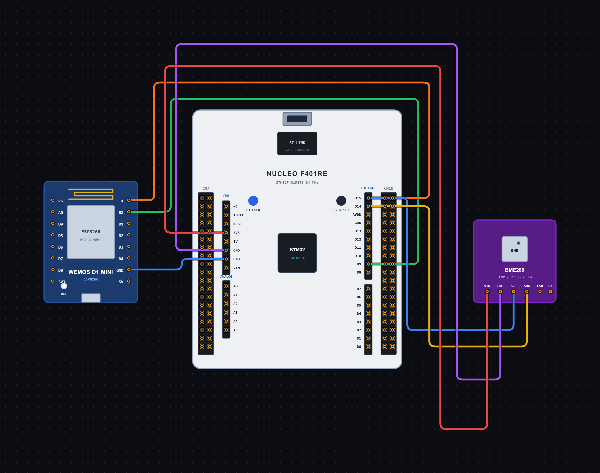

# Experiment Documentation

| Field | Description |
| :--- | :--- |
| **EXP** | CAT13 |
| **DATE** | 23/10/2026 |
| **NAME OF EXP** | BME280 Environmental Sensor Data Acquisition via I2C and UART on STM32F411RE |
| **HARDWARE SETUP / PLATFORM** | STM32F411RE (Nucleo-64), ARM Cortex-M4, BME280 Sensor (I2C1: PB6-SCL, PB7-SDA), USART6 (PC6-TX, PC7-RX), USB-to-Serial adapter, 3.3V power |
| **TASK NO** | TASK13 |

---

## Circuit Diagram



> **Hardware Connections:**
> - **Microcontroller:** STM32F411RE (Nucleo-64)
> - **Pin(s) Used:** PB6 (SCL) → BME280 SCL; PB7 (SDA) → BME280 SDA; PC6 (TX) → USB-Serial RX
> - **Peripheral(s):** BME280 Environmental Sensor (I2C1), USART6
> - **Power Supply:** BME280 VCC → 3.3V; GND common

---

## Core Logic / Pseudocode / Code Base

### Overview
The BME280 driver is initialized with custom I2C read/write/delay callbacks over I2C1. Sensor data is read in a loop and formatted output is sent over USART6 every 1000 ms.

### Core Logic
1. Initialize HAL, I2C1, USART6; set up BME280 driver with user_i2c_read/write/delay callbacks
2. Call bme280_init(); configure oversampling settings; set sensor to forced/normal mode
3. In loop: read temperature, pressure, humidity; format and transmit via UART every 1000 ms

### Implementation Snippet
```c
dev.intf_ptr = &dev_addr;
dev.read = user_i2c_read;
dev.write = user_i2c_write;
dev.delay_us = user_delay_us;
rslt = bme280_init(&dev);
// In loop:
int len = snprintf(uart_buffer, sizeof(uart_buffer),
    "Temp: %.2f C | Press: %.2f hPa | Hum: %.2f %%\r\n",
    temperature, pressure, humidity);
HAL_UART_Transmit(&huart6, (uint8_t *)uart_buffer, len, HAL_MAX_DELAY);
HAL_Delay(1000);
```

---

## Inference
The BME280 sensor was successfully initialized over I2C. Temperature, pressure, and humidity readings were periodically transmitted over UART6, confirming I2C peripheral driver integration and real-time environmental sensing.
