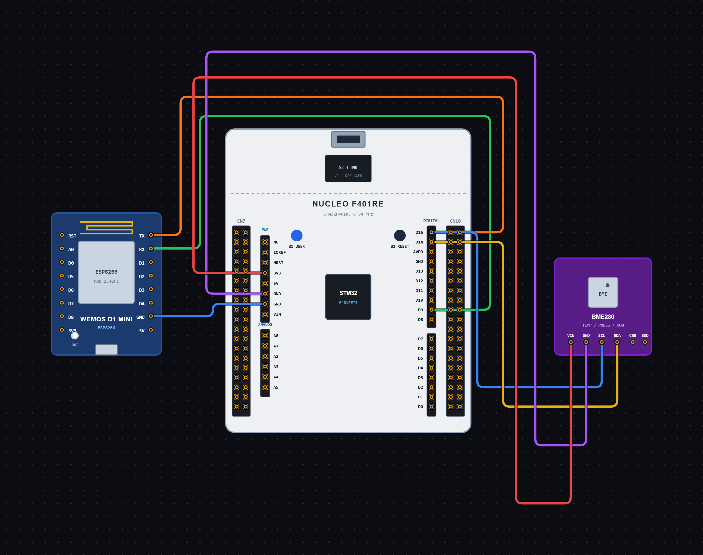

# Experiment Documentation

| Field | Description |
| :--- | :--- |
| **EXP** | CAT14 |
| **DATE** | 29/10/2026 |
| **NAME OF EXP** | IoT Sensor Data Publishing – BME280 Environmental Data via ESP8266 Wi-Fi on STM32F411RE |
| **HARDWARE SETUP / PLATFORM** | STM32F411RE (Nucleo-64), ARM Cortex-M4, BME280 Sensor (I2C1: PB6-SCL, PB7-SDA), ESP8266 Wi-Fi Module (USART1: PA9-TX, PA10-RX), ST-Link V2, 3.3V power |
| **TASK NO** | TASK14 |

---

## Circuit Diagram



> **Hardware Connections:**
> - **Microcontroller:** STM32F411RE (Nucleo-64)
> - **Pin(s) Used:** PB6 → BME280 SCL; PB7 → BME280 SDA; PA9 (TX) → ESP8266 RX; PA10 (RX) → ESP8266 TX
> - **Peripheral(s):** BME280 Sensor (I2C1), ESP8266 Wi-Fi Module (USART1)
> - **Power Supply:** 3.3V to BME280 and ESP8266; GND common

---

## Core Logic / Pseudocode / Code Base

### Overview
BME280 sensor data is read over I2C1 and transmitted to a remote IoT server via the ESP8266 using AT commands over USART1, forming a complete embedded IoT pipeline.

### Core Logic
1. Initialize HAL, I2C1, USART1; initialize BME280 sensor
2. Send "AT+RST" to reset ESP8266; configure Wi-Fi station mode and join network
3. In loop: read BME280 data; format HTTP request packet; use AT+CIPSTART and AT+CIPSEND to publish data to remote server

### Implementation Snippet
```c
HAL_UART_Transmit(&huart1, (uint8_t *)"AT+RST\r\n", 8, 500);
HAL_Delay(2000);
// Join WiFi, then in loop:
HAL_UART_Transmit(&huart1, (uint8_t *)packet, strlen(packet), HAL_MAX_DELAY);
HAL_Delay(1000);
```

---

## Inference
BME280 sensor readings were packaged and transmitted to a remote IoT endpoint via ESP8266 using AT commands over USART1. Successful HTTP data upload confirmed end-to-end IoT pipeline: sensor → microcontroller → Wi-Fi → cloud.
