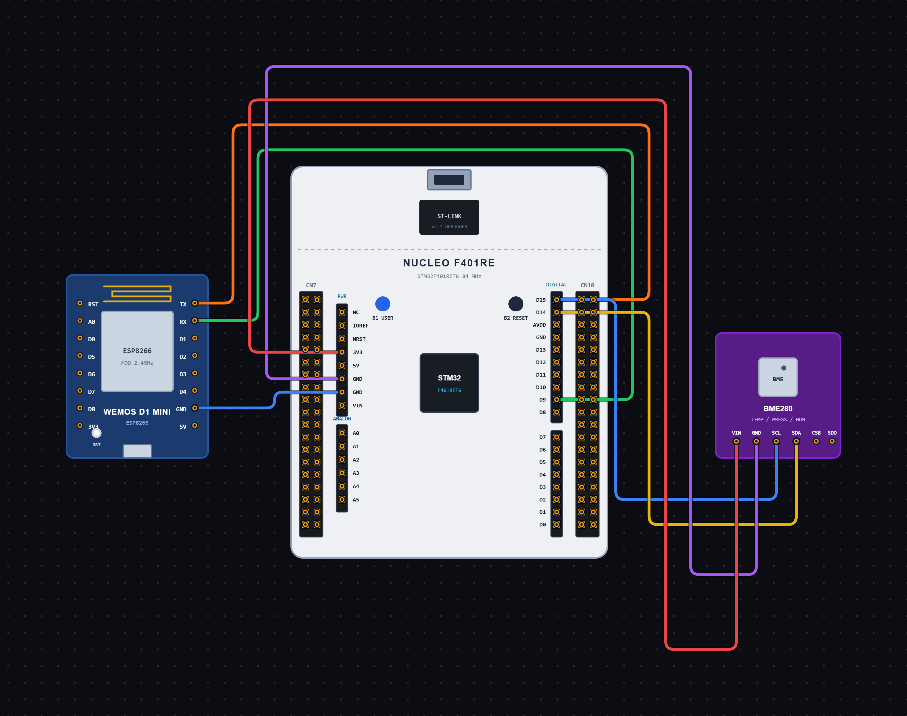

# Experiment Documentation

| Field | Description |
| :--- | :--- |
| **EXP** | CAT15 |
| **DATE** | 12/11/2026 |
| **NAME OF EXP** | IoT Environmental Monitoring – Extended BME280 Data Publishing via ESP8266 on STM32F411RE |
| **HARDWARE SETUP / PLATFORM** | STM32F411RE (Nucleo-64), ARM Cortex-M4, BME280 Sensor (I2C1: PB6-SCL, PB7-SDA), ESP8266 Wi-Fi Module (USART1: PA9-TX, PA10-RX), ST-Link V2, 3.3V power |
| **TASK NO** | TASK15 |

---

## Circuit Diagram



> **Hardware Connections:**
> - **Microcontroller:** STM32F411RE (Nucleo-64)
> - **Pin(s) Used:** PB6 → BME280 SCL; PB7 → BME280 SDA; PA9 (TX) → ESP8266 RX; PA10 (RX) → ESP8266 TX
> - **Peripheral(s):** BME280 Sensor (I2C1), ESP8266 Wi-Fi Module (USART1)
> - **Power Supply:** 3.3V to BME280 and ESP8266; GND common

---

## Core Logic / Pseudocode / Code Base

### Overview
Extended IoT monitoring pipeline: BME280 sensor readings are continuously polled over I2C1 and pushed to a remote IoT server via ESP8266 (AT commands over USART1) with enhanced error handling and stable loop management.

### Core Logic
1. Initialize HAL, I2C1, USART1; initialize BME280 with custom I2C callbacks
2. Reset ESP8266 (AT+RST), set station mode, join network, establish TCP connection
3. In loop: read sensor data; construct and send HTTP POST packet; delay; repeat

### Implementation Snippet
```c
HAL_UART_Transmit(&huart1, (uint8_t *)"AT+RST\r\n", 8, 500);
HAL_Delay(2000);
// Loop: read BME280, build packet, AT+CIPSEND
if (HAL_UART_Transmit(&huart1, (uint8_t *)packet, strlen(packet), HAL_MAX_DELAY) == HAL_OK) {
    HAL_Delay(1000);
}
```

---

## Inference
Extended environmental monitoring pipeline was validated with BME280 readings continuously pushed to the IoT server via ESP8266. The system ran stably, confirming reliable UART-driven Wi-Fi data transfer and I2C sensor polling in a production-like embedded IoT setup.
