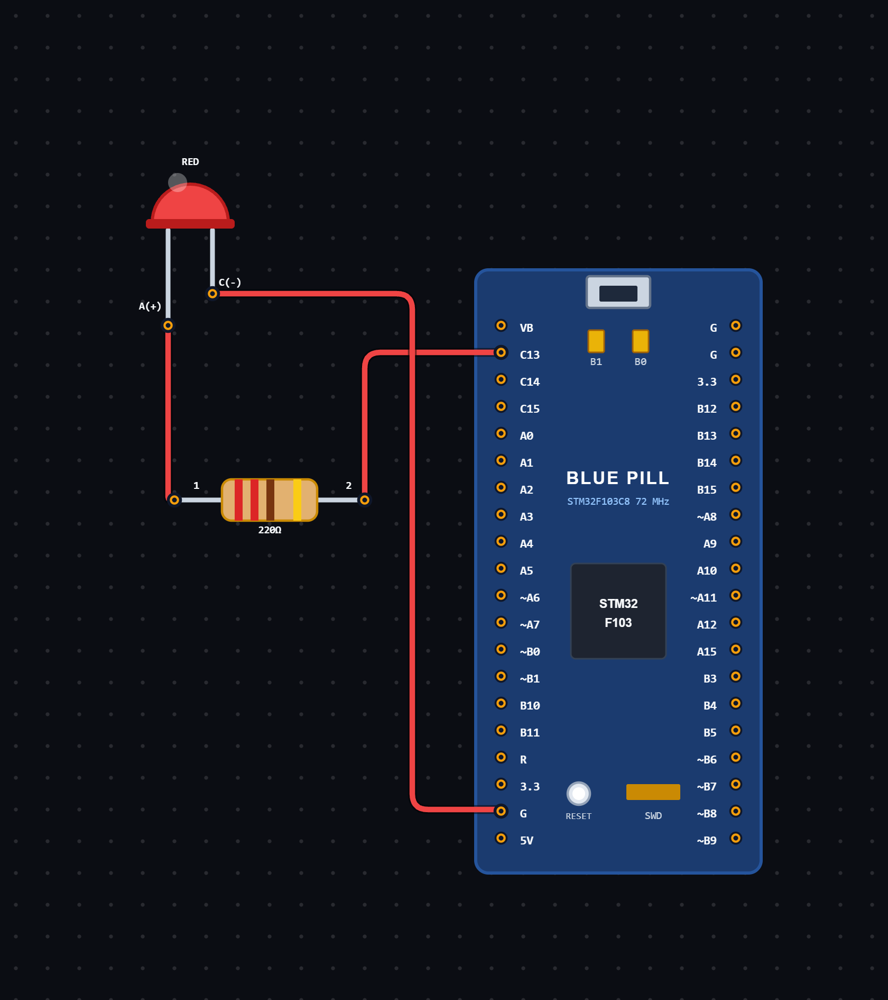

# Experiment Documentation

| Field | Description |
| :--- | :--- |
| **EXP** | CAT8 |
| **DATE** | 24/09/2026 |
| **NAME OF EXP** | LED Blinking using GPIO on STM32F103C8T6 |
| **HARDWARE SETUP / PLATFORM** | STM32F103C8T6 (Blue Pill), ARM Cortex-M3, On-board User LED (PC13), ST-Link V2 |
| **TASK NO** | TASK8A |

---

## Circuit Diagram



> **Hardware Connections:**
> - **Microcontroller:** STM32F103C8T6 (Blue Pill)
> - **Pin(s) Used:** PC13 → On-board LED (active-low)
> - **Peripheral(s):** On-board User LED
> - **Power Supply:** 3.3V via ST-Link

---

## Core Logic / Pseudocode / Code Base

### Overview
GPIO PC13 is configured as a push-pull output to drive the on-board active-low LED. The main loop toggles the pin state with 500 ms delays to produce a 1 Hz blink.

### Core Logic
1. Initialize HAL and system clock
2. Enable GPIOC clock, configure PC13 as Output Push-Pull
3. In infinite loop: Drive PC13 LOW (LED ON) → HAL_Delay(500) → Drive PC13 HIGH (LED OFF) → HAL_Delay(500)

### Implementation Snippet
```c
while (1)
{
    HAL_GPIO_WritePin(GPIOC, GPIO_PIN_13, GPIO_PIN_RESET); // LED ON
    HAL_Delay(500);
    HAL_GPIO_WritePin(GPIOC, GPIO_PIN_13, GPIO_PIN_SET);   // LED OFF
    HAL_Delay(500);
}
```

---

## Inference
GPIO PC13 on the STM32F103C8T6 Blue Pill was successfully configured as a push-pull output. The on-board LED blinked at 1 Hz (500 ms ON / 500 ms OFF), confirming the GPIO output and HAL_Delay functions work correctly.
