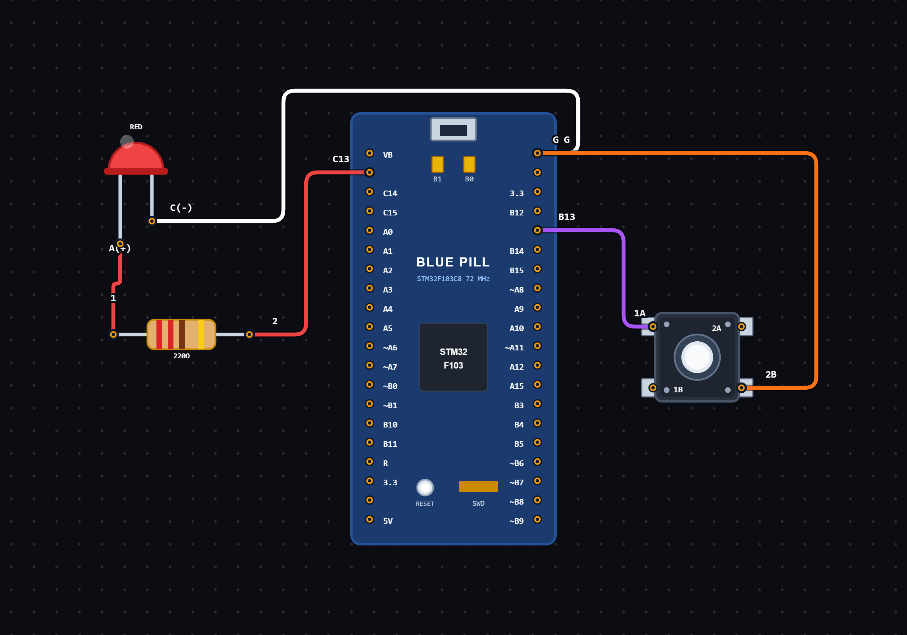

# Experiment Documentation

| Field | Description |
| :--- | :--- |
| **EXP** | CAT8 |
| **DATE** | 24/09/2026 |
| **NAME OF EXP** | Push Button Controlled LED using GPIO on STM32F103C8T6 |
| **HARDWARE SETUP / PLATFORM** | STM32F103C8T6 (Blue Pill), ARM Cortex-M3, On-board LED (PC13), External Push Button (PB13 / GPIOB PIN13), Pull-up resistor, ST-Link V2 |
| **TASK NO** | TASK8B |

---

## Circuit Diagram



> **Hardware Connections:**
> - **Microcontroller:** STM32F103C8T6 (Blue Pill)
> - **Pin(s) Used:** PB13 → External Push Button (input pull-up); PC13 → On-board LED (active-low)
> - **Peripheral(s):** On-board LED, External Push Button
> - **Power Supply:** 3.3V via ST-Link

---

## Core Logic / Pseudocode / Code Base

### Overview
PB13 is configured as an input with internal pull-up to read an external push button (active-low). PC13 drives the on-board LED. The main loop polls the button state and sets the LED accordingly.

### Core Logic
1. Initialize HAL and system clock
2. Configure PC13 as Output Push-Pull; configure PB13 as Input Pull-Up
3. In infinite loop: Read PB13 — if LOW (button pressed) → drive PC13 LOW (LED ON); else → drive PC13 HIGH (LED OFF)

### Implementation Snippet
```c
while (1)
{
    if (HAL_GPIO_ReadPin(GPIOB, GPIO_PIN_13) == GPIO_PIN_RESET)
    {
        HAL_GPIO_WritePin(GPIOC, GPIO_PIN_13, GPIO_PIN_RESET); // LED ON
    }
    else
    {
        HAL_GPIO_WritePin(GPIOC, GPIO_PIN_13, GPIO_PIN_SET);   // LED OFF
    }
}
```

---

## Inference
The external push button on PB13 was read in polling mode. The LED on PC13 remained ON only while the button was held pressed (active-low), confirming basic digital input reading and output control.
