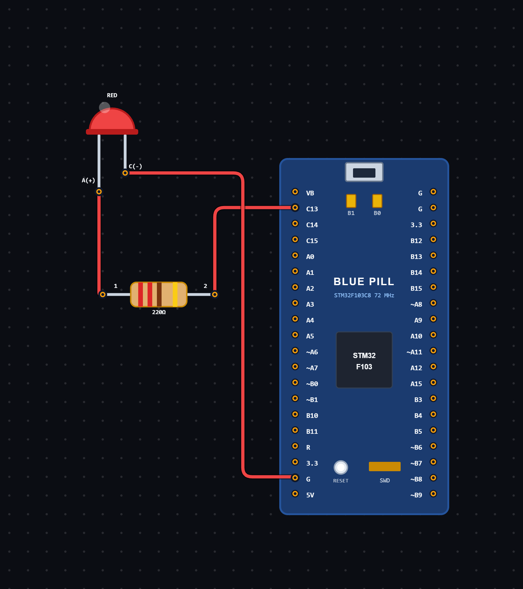

# Experiment Documentation

| Field | Description |
| :--- | :--- |
| **EXP** | CAT8 |
| **DATE** | 24/09/2026 |
| **NAME OF EXP** | Debounced Button with Short Press Toggle and Long Press Blink Mode on STM32F103C8T6 |
| **HARDWARE SETUP / PLATFORM** | STM32F103C8T6 (Blue Pill), ARM Cortex-M3, On-board LED (PC13), External Push Button (PB13), Pull-up resistor, ST-Link V2 |
| **TASK NO** | TASK8C |

---

## Circuit Diagram



> **Hardware Connections:**
> - **Microcontroller:** STM32F103C8T6 (Blue Pill)
> - **Pin(s) Used:** PB13 → External Push Button (input pull-up); PC13 → On-board LED (active-low)
> - **Peripheral(s):** On-board LED, External Push Button
> - **Power Supply:** 3.3V via ST-Link

---

## Core Logic / Pseudocode / Code Base

### Overview
Software debouncing via HAL_GetTick() candidate-time filtering distinguishes short and long button presses. A short press toggles the LED once; a long press activates an automatic 500 ms blink mode.

### Core Logic
1. Initialize HAL and system clock; configure PC13 output, PB13 input pull-up
2. Use HAL_GetTick() for software debouncing (candidate time comparison)
3. Track press start time; if button held > threshold → long press → enter blinkMode (auto-toggle LED every 500 ms)
4. Short press (< threshold) on release → toggle LED once
5. Use LED_On/LED_Off/LED_Toggle helper functions to manage active-low LED state

### Implementation Snippet
```c
uint8_t reading = HAL_GPIO_ReadPin(GPIOB, GPIO_PIN_13);
if(reading != lastButtonReading) { candidateTime = currentTime; }
if((currentTime - candidateTime) > DEBOUNCE_MS) {
    buttonState = reading;
}
if(buttonState == GPIO_PIN_RESET && !longPressHandled) {
    if((currentTime - pressStart) > LONG_PRESS_MS) {
        blinkMode = 1; longPressHandled = 1;
    }
}
```

---

## Inference
Software debouncing via time-based candidate filtering eliminated false triggers from mechanical bounce. Short press correctly toggled the LED once; long press activated an automatic 500 ms blink mode, demonstrating advanced GPIO input handling.
