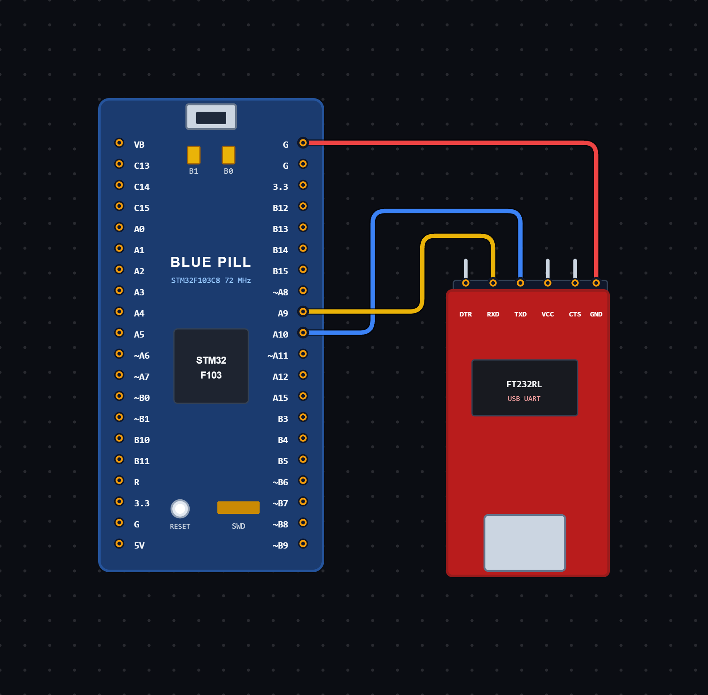

# Experiment Documentation

| Field | Description |
| :--- | :--- |
| **EXP** | CAT9 |
| **DATE** | 01/10/2026 |
| **NAME OF EXP** | UART Serial Communication – Transmit and Echo on STM32F103C8T6 |
| **HARDWARE SETUP / PLATFORM** | STM32F103C8T6 (Blue Pill), ARM Cortex-M3, USART1 (PA9-TX, PA10-RX), USB-to-Serial (FTDI/CH340) adapter, ST-Link V2 |
| **TASK NO** | TASK9A |

---

## Circuit Diagram



> **Hardware Connections:**
> - **Microcontroller:** STM32F103C8T6 (Blue Pill)
> - **Pin(s) Used:** PA9 (TX) → RX of USB-Serial adapter; PA10 (RX) → TX of USB-Serial adapter
> - **Peripheral(s):** USART1, USB-to-Serial adapter
> - **Power Supply:** 3.3V via ST-Link; GND common

---

## Core Logic / Pseudocode / Code Base

### Overview
USART1 is configured at 9600 baud, 8N1. The firmware periodically transmits a "T" beacon every 1000 ms and echoes any received data back using idle-line detection.

### Core Logic
1. Initialize HAL, system clock; configure USART1 (9600 baud, 8N1)
2. Every 1000 ms, transmit "T\r\n" over USART1
3. Continuously attempt to receive data using HAL_UARTEx_ReceiveToIdle with 10 ms timeout
4. If data received (rxLen > 0), echo it back via HAL_UART_Transmit

### Implementation Snippet
```c
if(currentTime - lastTx >= 1000) {
    HAL_UART_Transmit(&huart1, txData, sizeof(txData)-1, HAL_MAX_DELAY);
    lastTx = currentTime;
}
HAL_UARTEx_ReceiveToIdle(&huart1, rxBuffer, sizeof(rxBuffer), &rxLen, 10);
if(rxLen > 0) {
    HAL_UART_Transmit(&huart1, rxBuffer, rxLen, HAL_MAX_DELAY);
}
```

---

## Inference
USART1 was configured successfully at 9600 baud. Periodic "T" beacon transmission and idle-line-based echo reception were verified using a serial terminal, demonstrating reliable polling-based UART communication.
