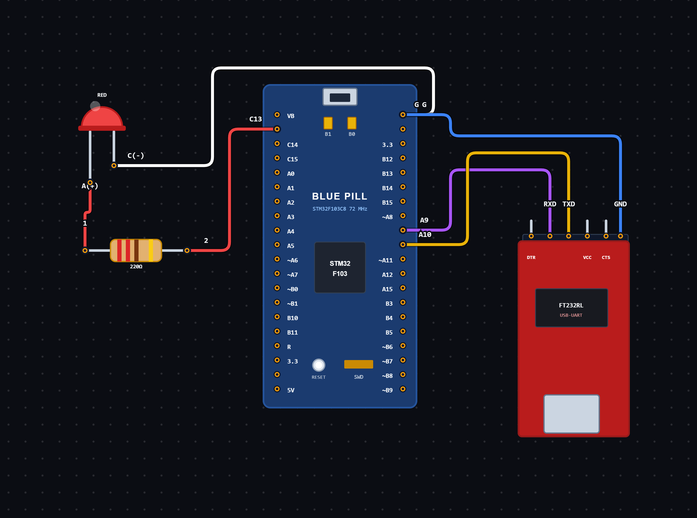

# Experiment Documentation

| Field | Description |
| :--- | :--- |
| **EXP** | CAT9 |
| **DATE** | 01/10/2026 |
| **NAME OF EXP** | UART Command-Controlled LED on STM32F103C8T6 |
| **HARDWARE SETUP / PLATFORM** | STM32F103C8T6 (Blue Pill), ARM Cortex-M3, USART1 (PA9-TX, PA10-RX), On-board LED (PC13), USB-to-Serial adapter, ST-Link V2 |
| **TASK NO** | TASK9B |

---

## Circuit Diagram



> **Hardware Connections:**
> - **Microcontroller:** STM32F103C8T6 (Blue Pill)
> - **Pin(s) Used:** PA9 (TX) → RX of adapter; PA10 (RX) → TX of adapter; PC13 → On-board LED (active-low)
> - **Peripheral(s):** USART1, USB-to-Serial adapter, On-board LED
> - **Power Supply:** 3.3V via ST-Link; GND common

---

## Core Logic / Pseudocode / Code Base

### Overview
USART1 receives text commands byte by byte, accumulates into a buffer, and on newline compares against "LED ON", "LED OFF", "LED TOGGLE" to control PC13.

### Core Logic
1. Initialize HAL, system clock; configure USART1 and GPIO PC13
2. In loop: receive 1 byte at a time from USART1; accumulate into buffer until '\r' or '\n'
3. On newline: compare buffer to "LED ON" → LED ON; "LED OFF" → LED OFF; "LED TOGGLE" → toggle LED
4. Reset buffer index after each command

### Implementation Snippet
```c
HAL_UART_Receive(&huart1, &rx, 1, HAL_MAX_DELAY);
if (rx == '\r' || rx == '\n') {
    buffer[index] = '\0';
    if (strcmp(buffer, "LED ON") == 0)
        HAL_GPIO_WritePin(GPIOC, GPIO_PIN_13, GPIO_PIN_RESET);
    else if (strcmp(buffer, "LED OFF") == 0)
        HAL_GPIO_WritePin(GPIOC, GPIO_PIN_13, GPIO_PIN_SET);
    else if (strcmp(buffer, "LED TOGGLE") == 0)
        HAL_GPIO_TogglePin(GPIOC, GPIO_PIN_13);
    index = 0;
} else { buffer[index++] = rx; }
```

---

## Inference
Text commands sent over UART from a serial terminal successfully controlled the LED state. String comparison with strcmp() correctly parsed "LED ON", "LED OFF", and "LED TOGGLE", demonstrating UART-based command parsing.
